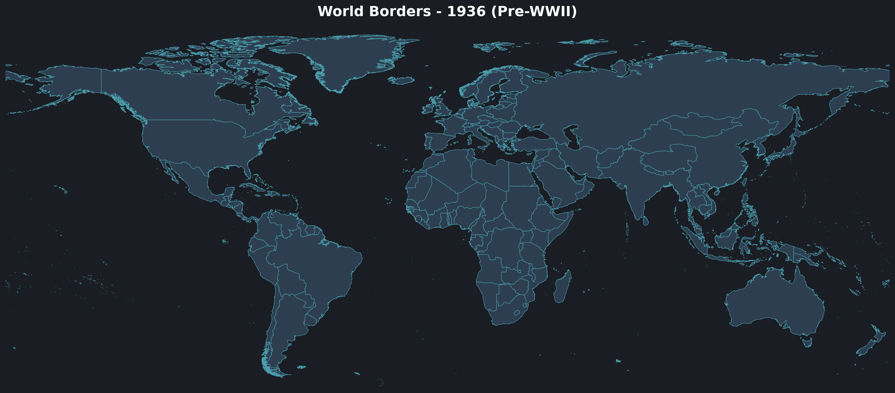

# 🗺️ Historical World Borders GeoJSON

High-quality, cleaned, and high-resolution historical world boundaries in GeoJSON format across key eras in modern history (**1914**, **1936**, **1950**, **2010**, **2026**).

Enhanced with high-fidelity modern coastlines, solving the jagged borders, missing islands, and coastal-sliver issues common in raw historical shapefiles.



---

## 📦 Available Maps & Formats

We provide three tiers of resolution for each historical era:

| Year | Era / Description | Ultra High-Detail (4K / GIS) | Standard (Web-Ready / < 5MB) | Low (Fast / < 2MB) |
| :--- | :--- | :---: | :---: | :---: |
| **1914** | Eve of World War I | [Download (25.0 MB)](maps/high-detail/world_1914.geojson) | [Download (4.9 MB)](maps/standard/world_1914.geojson) | [Download (1.8 MB)](maps/low/world_1914.geojson) |
| **1936** | Interwar / Pre-WWII | [Download (22.5 MB)](maps/high-detail/world_1936.geojson) | [Download (4.5 MB)](maps/standard/world_1936.geojson) | [Download (1.4 MB)](maps/low/world_1936.geojson) |
| **1950** | Early Cold War / Post-WWII | [Download (22.8 MB)](maps/high-detail/world_1950.geojson) | [Download (4.6 MB)](maps/standard/world_1950.geojson) | [Download (1.4 MB)](maps/low/world_1950.geojson) |
| **2010** | Modern Baseline | [Download (22.5 MB)](maps/high-detail/world_2010.geojson) | [Download (4.5 MB)](maps/standard/world_2010.geojson) | [Download (1.4 MB)](maps/low/world_2010.geojson) |
| **2026** | Contemporary Baseline | [Download (26.8 MB)](maps/high-detail/world_2026.geojson) | [Download (5.0 MB)](maps/standard/world_2026.geojson) | [Download (1.8 MB)](maps/low/world_2026.geojson) |

- **Ultra High-Detail (~23-25 MB)**: Ultra-dense coordinates with sub-kilometer fidelity for 4K video rendering, GIS analysis (QGIS, ArcGIS), and high-resolution prints.
- **Standard (Web-Ready) (~4.6 MB)**: Lightweight, smooth, topology-preserving geometry (< 5 MB) optimized for Web apps (Leaflet, Mapbox, D3.js) and fast network transfers.
- **Low (Fast / Mobile) (< 2 MB)**: Ultra-compact, topology-preserved geometry with 4-decimal precision (~1.4 MB) optimized for instant mobile loading, low-bandwidth environments, and high-performance charting.

> [!TIP]
> **Interactive GitHub Preview**: All files render interactively right in GitHub's web interface! You can click on any map link above to pan, zoom, and inspect historical borders directly in your browser.

---

## 📊 Feature Properties

Each country feature in the GeoJSON contains the following properties:

| Property | Type | Description | Example |
| :--- | :--- | :--- | :--- |
| `cntry_name` | `string` | Common historical country name | `"France"` |
| `capname` | `string` | Historical capital city name | `"Paris"` |
| `caplat` | `float` | Latitude of capital city | `48.85` |
| `caplong` | `float` | Longitude of capital city | `2.35` |
| `area` | `float` | Territory area | `551500.0` |
| `gwcode` | `int` | Gleditsch-Ward historical state code | `220` |

* **CRS**: Standard GPS coordinates (`EPSG:4326` / WGS84) with `[longitude, latitude]` order (RFC 7946 compliant).

---

## 🚀 Quickstart

### Python (GeoPandas)
```python
import geopandas as gpd
import matplotlib.pyplot as plt

# Load 1936 map
gdf = gpd.read_file("maps/standard/world_1936.geojson")

# Plot
fig, ax = plt.subplots(figsize=(14, 7))
gdf.plot(ax=ax, color="#E4D5B7", edgecolor="#5C4033", linewidth=0.5)
ax.axis("off")
plt.title("World Borders - 1936")
plt.show()
```

### JavaScript (Leaflet)
```javascript
fetch("maps/standard/world_1936.geojson")
  .then(response => response.json())
  .then(data => {
    L.geoJSON(data, {
      style: {
        color: "#5C4033",
        weight: 1,
        fillColor: "#E4D5B7",
        fillOpacity: 0.8
      },
      onEachFeature: (feature, layer) => {
        layer.bindPopup(`<b>${feature.properties.cntry_name}</b><br>Capital: ${feature.properties.capname}`);
      }
    }).addTo(map);
  });
```

---

## 🛠️ Coastline Upscaler Tool (`tools/upscale_coastlines.py`)

Want to upscale your own historical maps? We've open-sourced the standalone tool used to produce the **Ultra High-Detail** map.

### How it Works (The Coastal Slivers Algorithm)
Raw historical datasets often have jagged, coarse coastlines and missing islands. This tool:
1. Compares raw historical borders against modern high-resolution land polygons (e.g. Natural Earth 10m).
2. Isolates the missing coastal slivers and coastal islands.
3. Snaps each coastal sliver to the nearest historical nation using spatial nearest-neighbor joins (`sjoin_nearest`) with deduplication.
4. **Strictly preserves internal historical borders** while elevating coastlines to sub-kilometer resolution.

### Usage
```bash
# 1. Install dependencies
pip install -r tools/requirements.txt

# 2. Run upscaler
python tools/upscale_coastlines.py \
  --input path/to/raw_historical_map.geojson \
  --reference path/to/high_res_land.geojson \
  --output path/to/upscaled_map.geojson
```

---

## 🗺️ Roadmap
We plan to release additional historical eras:
- [x] **1936**: Interwar / Pre-WWII
- [x] **1950**: Early Cold War / Post-WWII
- [x] **2010**: Modern Baseline
- [x] **1914**: Eve of World War I
- [x] **2026**: Contemporary Baseline
- [ ] **1939**: Outbreak of World War II
- [ ] **1941**: Axis Expansion Peak
- [ ] **1890**: High Imperialism era

---

## 📄 License & Attribution

- **Data**: Released under [Creative Commons Attribution 4.0 International (CC-BY 4.0)](LICENSE).
- **Sources**: Base historical political entities reference the CShapes dataset and Natural Earth coastlines.
